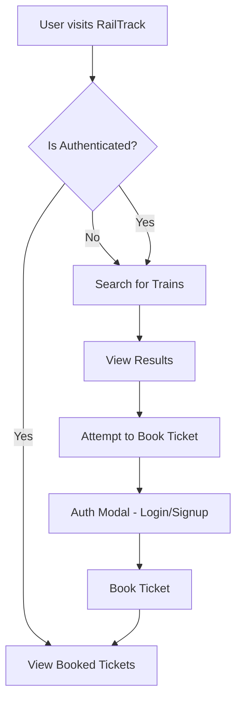

# RailTrack - Railway Management System

## Project Overview
RailTrack is a full-stack, modern Railway Management System built to facilitate easy train searching, seamless booking, and ticket management. It provides an intuitive interface for users to search for trains between stations, view detailed schedules, authenticate securely, and book their journeys.

## Key Features
- **Real-time Train Search:** Look up trains by source and destination.
- **Secure User Authentication:** Login and sign-up powered by Supabase.
- **Ticket Booking System:** Seamlessly book tickets for scheduled trains.
- **My Tickets Dashboard:** View and manage your upcoming bookings.
- **Responsive Design:** A beautiful, fully responsive UI built with Tailwind CSS.

## Tools & Technologies Used
- **Frontend Framework:** React 18 with TypeScript
- **Build Tool:** Vite
- **Styling:** Tailwind CSS
- **Backend & Database:** Supabase (PostgreSQL)
- **Icons:** Lucide React

## Application Workflow



## Setup & Run Instructions

To run this project locally, follow these steps:

### Prerequisites
Make sure you have [Node.js](https://nodejs.org/) and `npm` installed on your machine.

### Installation

1. **Clone the repository** (if you haven't already):
   ```bash
   git clone https://github.com/Abhi200550/booking.git
   cd booking
   ```

2. **Install dependencies:**
   ```bash
   npm install
   ```

3. **Set up Environment Variables:**
   Create a `.env` file in the root directory and add your Supabase credentials.
   ```env
   VITE_SUPABASE_URL=your_supabase_project_url
   VITE_SUPABASE_ANON_KEY=your_supabase_anon_key
   ```

4. **Run the Development Server:**
   ```bash
   npm run dev
   ```

5. **Open your browser:**
   Navigate to `http://localhost:5173/` to view the app in action!
